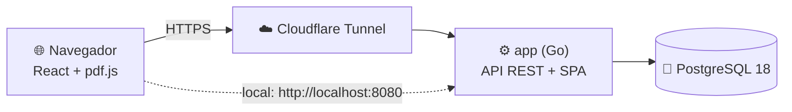
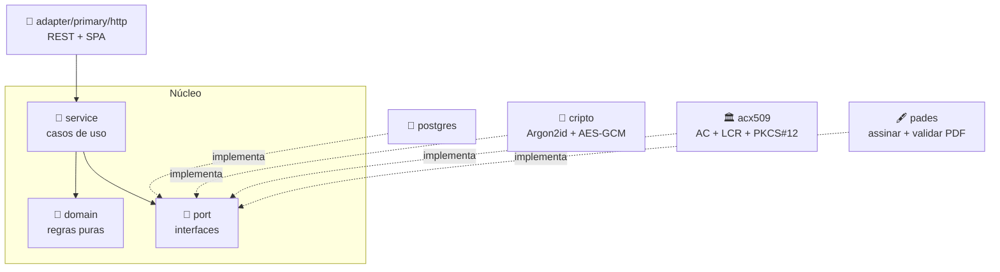
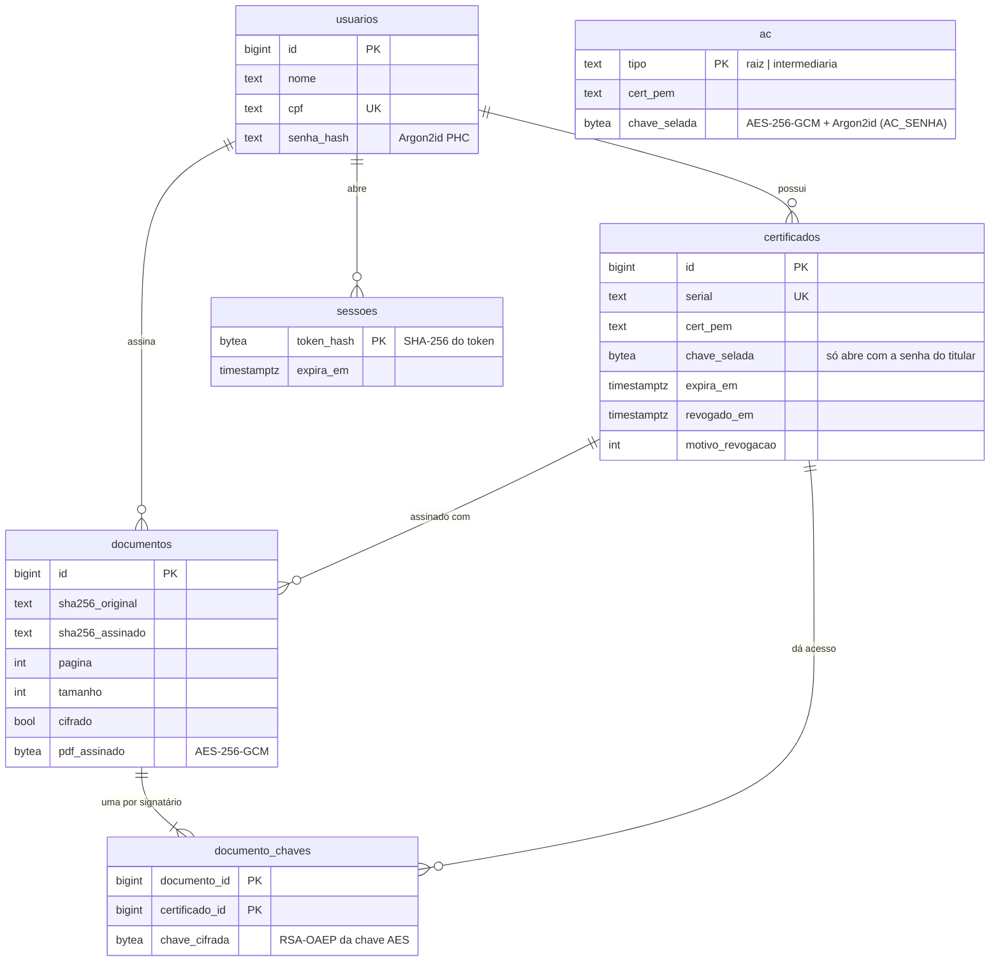

# 🏗️ Arquitetura

> 🗣️ **Em palavras simples:** o sistema é **um programa em Go** que faz duas coisas: entrega as telas do site (feitas em React) e responde às ações (criar conta, assinar, validar). Tudo é guardado num **banco PostgreSQL**. Os dois rodam em containers Docker.

## 🧭 Visão geral



Um único binário Go serve **a API** (`/api/...`) e **os arquivos do frontend** já compilados (SPA). Tudo cabe numa imagem Docker só.

---

## ⚙️ Backend: hexagonal (portas e adaptadores)

> 🗣️ **Em palavras simples:** as regras do negócio (o que é um CPF válido, quando um certificado pode assinar...) ficam no centro, sem saber nada de banco de dados, web ou bibliotecas de criptografia. Cada tecnologia é uma "peça encaixável" em volta. Assim dá para testar as regras sem banco e trocar uma tecnologia sem mexer nas regras.

Segue a skill `golang-design-patterns` (em `.agents/skills/`). O **domínio** fica no centro e não importa nada de infraestrutura. Os **serviços** falam com o mundo externo só por **interfaces (portas)**, e cada tecnologia fica isolada num **adaptador**.



```
backend/
├── cmd/server/main.go                 🚪 raiz de composição: lê o ambiente, monta os adaptadores e injeta nos serviços
└── internal/
    ├── domain/                        💎 regras puras (sem banco, HTTP ou crypto)
    │   ├── usuario.go                 CPF (value object, módulo 11), nome, política de senha
    │   ├── certificado.go             ciclo de vida: Situacao, Revogar, PodeAssinar, MotivoRevogacao (RFC 5280)
    │   ├── documento.go               Posicao/Retangulo do carimbo, PDF (value object)
    │   ├── validacao.go               regra "assinatura válida" e revogação antes ou depois de assinar
    │   └── erros.go                   erros de negócio (o adaptador HTTP traduz para status)
    ├── port/
    │   ├── incoming.go                ➡️ portas primárias: ContaService, CertificadoService, AssinaturaService...
    │   └── outgoing.go                ⬅️ portas secundárias: repositórios, Cofre, HasherSenha, AutoridadeCertificadora, AssinadorPDF, ValidadorPDF
    ├── service/                       🧠 casos de uso (implementam as portas primárias)
    └── adapter/
        ├── primary/http/              🔌 REST + SPA; DTOs JSON; erro de domínio → status HTTP
        └── secondary/
            ├── postgres/              🐘 repositórios com pgx v5 + schema
            ├── cripto/                🧂 Argon2id (hash de senha + derivação de chave), AES-256-GCM, tokens
            ├── acx509/                🏛️ AC Raiz → Intermediária → usuário, LCR, PKCS#12 (crypto/x509)
            └── pades/                 🖋️ assinatura e validação PAdES + carimbo visual (digitorus/pdfsign)
```

### 🧩 Padrões aplicados

| Padrão | Exemplo |
|---|---|
| ⚙️ **Opções funcionais com validação** | `service.ComURLPublica`, `acx509.ComTamanhosDeChave`, `httpadapter.ComTamanhoMaximoPDF`: uma configuração inválida falha na construção, não durante a execução |
| ✅ **Verificação de interface em compilação** | `var _ port.Cofre = (*Argon2)(nil)` |
| 🚫 **Sem `init()` nem estado global** | tudo é construído no `main`, inclusive o relógio (injetável nos testes) |
| 0️⃣ **Enums com zero inválido** | `SituacaoDesconhecida`; `MotivoRevogacao` usa os códigos da RFC 5280 e tem `Valido()` |
| ⏱️ **Limites e timeouts** | pool do Postgres com `MaxConns = 10`, `http.Server` com timeouts, upload de PDF limitado a 20 MiB, desligamento gracioso |
| 🧪 **Testabilidade** | `service_test.go` usa fakes em memória (sem banco nem RSA); `pades_test.go` integra AC, cofre e PAdES reais num PDF de verdade |

```bash
cd backend && go test -race ./...
```

---

## 🐘 Banco de dados

O schema é aplicado automaticamente na partida ([`postgres.go`](../backend/internal/adapter/secondary/postgres/postgres.go)).



---

## 🎨 Frontend: React + design "Nexus Neural"

```
frontend/src/
├── App.tsx                 🧭 roteador mínimo com history.pushState (sem dependências)
├── api.ts                  🔌 cliente da API
├── components/neural/      🌌 campo de partículas WebGL (Three.js + ShaderMaterial), carregado sob demanda
├── components/             PosicionadorPdf (pdf.js), SeletorArquivo, Modal, Icone
├── pages/                  Entrar, Assinar, Validar, Documentos, MeuCertificado, AutoridadeCertificadora
└── styles.css              🎨 tokens do design system
```

🔓 Rotas públicas: `/validar` e `/ac`. As demais (`/assinar`, `/documentos`, `/certificado`) pedem login.

* 🌑 Tema escuro `#0C0C0C`, superfícies `#121212` com borda `#2A2A2A`, acento lime `#C4F042` com brilho `0 0 8px`.
* 📐 Espaçamento em múltiplos de 6 px, raios de 5, 6 ou 9999 px, display de 48 px com tracking −0,025em.
* 🌌 Fundo WebGL com matriz de pontos verdes que "respira" e segue o ponteiro. Pausa com a aba oculta, respeita `prefers-reduced-motion` e tem **fallback em CSS** sem WebGL.
* 🎞️ Animações de 150, 300 ou 500 ms com `cubic-bezier(0.4, 0, 0.2, 1)`.

---

## 🐳 Imagem Docker

[`Dockerfile`](../Dockerfile) multi-stage:

| Estágio | Imagem | Resultado |
|---|---|---|
| 1️⃣ frontend | `node:26-alpine` | `npm ci` + `vite build` → `dist/` |
| 2️⃣ backend | `golang:1.27-alpine` | binário estático (`CGO_ENABLED=0`, `-s -w`) |
| 3️⃣ final | `alpine:3.24` | binário + `dist/`, usuário sem privilégios (uid 10001), healthcheck em `/api/ac` |

### 🔧 Variáveis de ambiente

| Variável | Padrão local | Descrição |
|---|---|---|
| `DATABASE_URL` | montada pelo compose | conexão com o PostgreSQL |
| `AC_SENHA` | `lcr-local-dev-ac-2026` | 🔐 cifra as chaves da AC (mín. 12 caracteres) |
| `POSTGRES_PASSWORD` | `lcr-local-dev-pg-2026` | 🐘 senha do banco |
| `PUBLIC_URL` | `http://localhost:8080` | 🌐 URL gravada nos certificados e no carimbo |
| `COOKIE_SECURE` | `false` | 🍪 `true` em produção (HTTPS) |
| `TZ_ASSINATURA` | `America/Sao_Paulo` | 🕐 fuso da data no carimbo |
| `LIMITE_ARGON2` | `4` | 🧂 cálculos Argon2id simultâneos (64 MiB cada) |
| `LIMITE_PDF` | `4` | 📄 requisições com PDF simultâneas (o resto espera; 503 após 30 s) |
| `GOMEMLIMIT` | `768MiB` | 🧹 alvo de memória do coletor de lixo do Go |
| `PORT` | `8080` | porta HTTP |
| `STATIC_DIR` | `/app/web` | pasta do frontend compilado |
