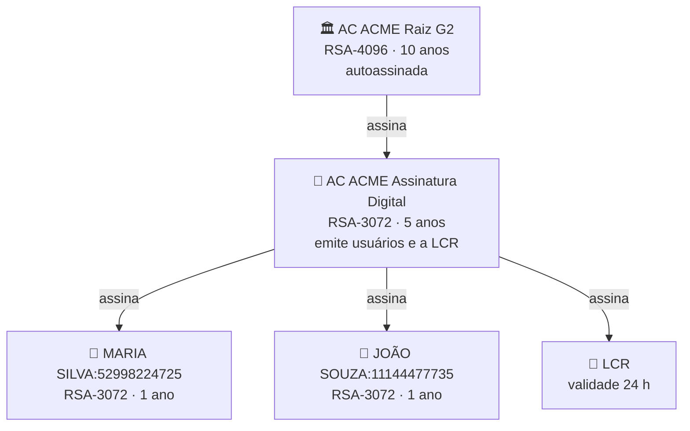
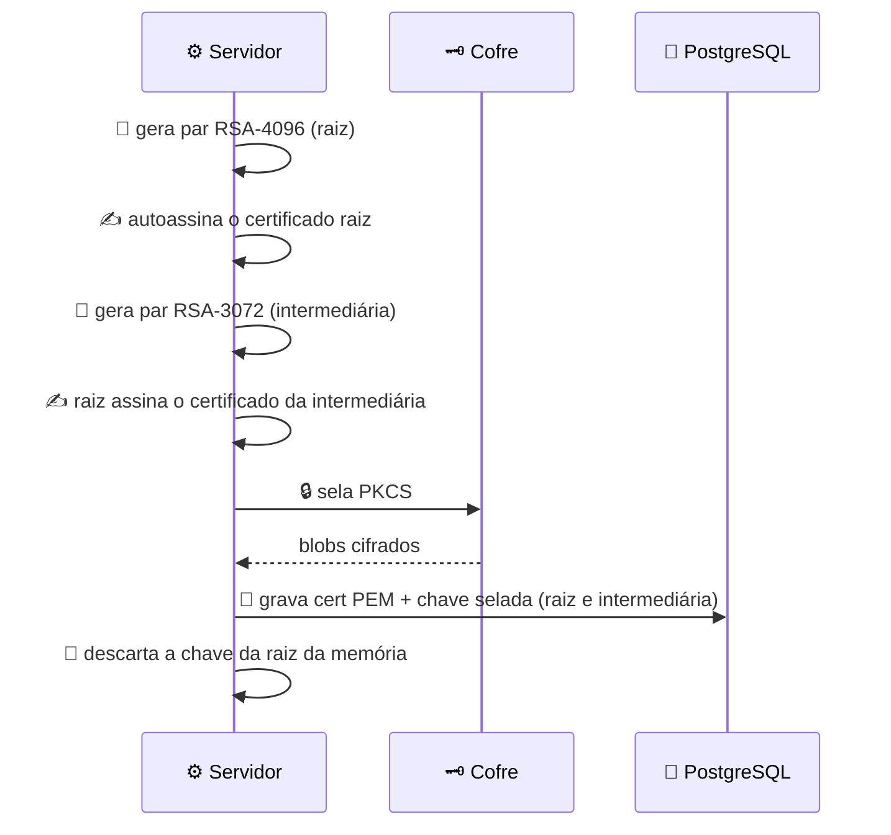
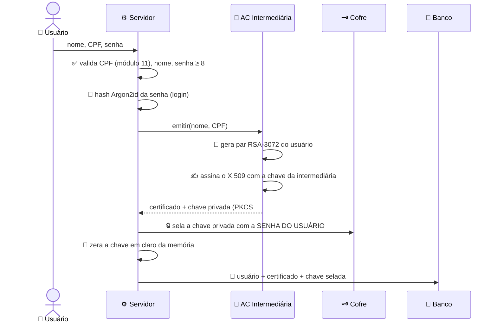
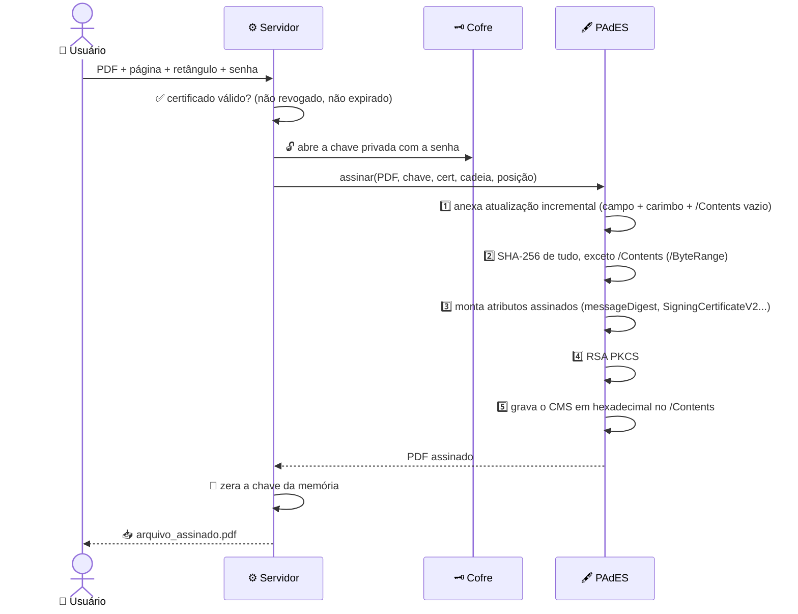
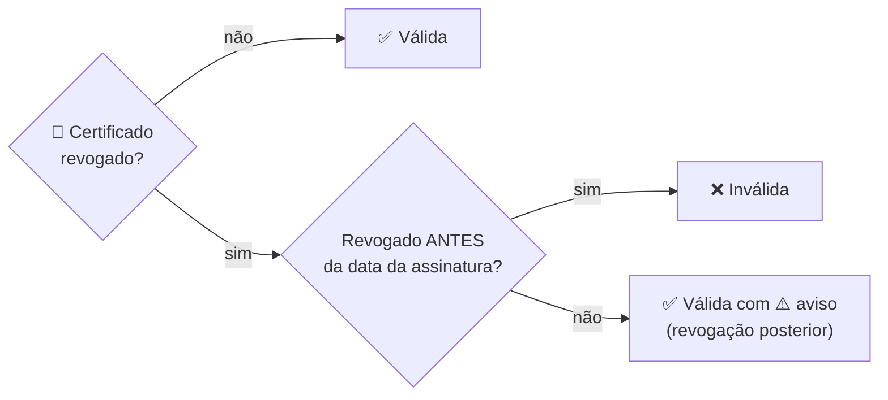

# 🔐 Como funcionam os certificados e a assinatura

Este documento explica, passo a passo, toda a criptografia do LCR Assina: da criação da AC até a validação de um PDF assinado. Cada seção aponta o arquivo do código onde aquilo acontece.

📑 **Sumário**

1. [🏛️ A hierarquia da AC ACME](#1-️-a-hierarquia-da-ac-acme)
2. [🌱 Primeira execução: nascimento da AC](#2--primeira-execução-nascimento-da-ac)
3. [🪪 Emissão do certificado do usuário](#3--emissão-do-certificado-do-usuário)
4. [🗝️ O cofre: onde fica a chave privada](#4-️-o-cofre-onde-fica-a-chave-privada)
5. [🔑 Senhas e sessões](#5--senhas-e-sessões)
6. [🖋️ Assinatura do PDF (PAdES)](#6-️-assinatura-do-pdf-pades)
7. [🔍 Validação do PDF](#7--validação-do-pdf)
8. [🚫 Revogação e LCR](#8--revogação-e-lcr)
9. [🔄 Renovação](#9--renovação)
10. [💾 Exportação `.pfx`](#10--exportação-pfx)
11. [📋 Resumo dos algoritmos](#11--resumo-dos-algoritmos)

---

## 1. 🏛️ A hierarquia da AC ACME

📄 Código: [`backend/internal/adapter/secondary/acx509/ac.go`](../backend/internal/adapter/secondary/acx509/ac.go)

A AC segue o mesmo modelo de dois níveis da ICP-Brasil:



| Certificado | Chave | Validade | Key Usage | Basic Constraints |
|---|---|---|---|---|
| 🏛️ **AC ACME Raiz G2** | RSA-4096 | 10 anos | Certificate Sign, CRL Sign | `CA:TRUE`, `pathLen:1` |
| 🏢 **AC ACME Assinatura Digital** | RSA-3072 | 5 anos | Certificate Sign, CRL Sign | `CA:TRUE`, `pathLen:0` (só emite certificados finais) |
| 👤 **NOME:CPF** | RSA-3072 | 1 ano | Digital Signature, Non Repudiation | `CA:FALSE` |

💡 **Por que dois níveis?** A raiz é o ponto de confiança de todo o sistema. Se a chave dela vazar, tudo cai. Por isso ela só é usada **uma vez**, para assinar a intermediária, e depois **não é carregada na memória** do servidor (é a chave "offline"). O trabalho do dia a dia (emitir certificados e assinar a LCR) fica com a intermediária. Se ela for comprometida, a raiz pode revogá-la e emitir outra.

🏷️ Os nomes seguem o padrão `C=BR, O=ACME, OU=Seguranca da Informacao, CN=...`.

---

## 2. 🌱 Primeira execução: nascimento da AC

📄 Função `criar()` em `acx509/ac.go`

Quando o servidor sobe e não encontra a AC na tabela `ac` do banco:



Nas execuções seguintes (`Carregar()`), o servidor lê os dois certificados e **abre só a chave da intermediária** com a `AC_SENHA`. A chave da raiz continua cifrada no banco.

🎲 **Número de série:** 128 bits aleatórios de `crypto/rand` (o CA/Browser Forum exige pelo menos 64 bits de entropia). Assim ninguém consegue prever o serial de um certificado futuro.

⚠️ Se a `AC_SENHA` mudar, o servidor não sobe: *"AC_SENHA não abre a chave da AC intermediária (a senha mudou?)"*.

---

## 3. 🪪 Emissão do certificado do usuário

📄 `AC.Emitir()` em `acx509/ac.go` e `service/conta.go`

Ao criar a conta (`POST /api/cadastro`):



📌 A AC emite **antes** de gravar o usuário: se a emissão falhar, não sobra conta sem certificado.

### 📜 Campos do certificado do usuário

| Campo X.509 | Valor | Para quê |
|---|---|---|
| **Subject** | `C=BR, O=ACME, OU=Colaboradores, CN=NOME:CPF` | identidade, no padrão ICP-Brasil |
| **Issuer** | `AC ACME Assinatura Digital` | quem emitiu |
| **Serial** | 128 bits aleatórios | identifica o certificado na LCR |
| **Validade** | 1 ano (como um A1) | |
| **Key Usage** | `Digital Signature`, `Non Repudiation` | pode assinar, e a assinatura tem valor de compromisso |
| **Extended Key Usage** | `Document Signing` (OID `1.3.6.1.5.5.7.3.36`, RFC 9336), `E-mail Protection`, `Client Auth` | uso específico para assinar documentos |
| **CRL Distribution Points** | `<PUBLIC_URL>/api/ac/lcr.crl` | onde consultar a revogação |
| **Authority Info Access** | `<PUBLIC_URL>/api/ac/intermediaria.crt` | onde baixar o certificado do emissor |
| **Assinatura** | SHA256-RSA (PKCS#1 v1.5) | feita pela chave da intermediária |

---

## 4. 🗝️ O cofre: onde fica a chave privada

📄 Código: [`backend/internal/adapter/secondary/cripto/cripto.go`](../backend/internal/adapter/secondary/cripto/cripto.go)

No gov.br você não recebe um `.pfx`: a chave fica no servidor e é liberada pelo login. Aqui é igual, mas a chave fica **cifrada com a sua senha**. Nem o administrador do banco consegue usá-la sem a senha.

### 🔒 Selar (cifrar)

```
                     🎲 salt (16 bytes aleatórios)
                              │
senha ──► Argon2id(t=3, m=64 MiB, p=4) ──► 🔑 chave AES de 256 bits
                                                  │
PKCS#8 da chave RSA ──► AES-256-GCM(🎲 nonce 12 B, AAD = contexto) ──► texto cifrado + tag 16 B
```

📦 Formato gravado no banco (coluna `BYTEA`):

```
┌──────┬────────────┬────────────┬─────────────────────────────┐
│ "v1" │ salt (16 B)│ nonce (12 B)│ ciphertext + tag GCM (16 B) │
└──────┴────────────┴────────────┴─────────────────────────────┘
```

| Peça | Função |
|---|---|
| 🧂 **Argon2id** (RFC 9106) | transforma a senha numa chave de 256 bits. É **lento e gasta 64 MiB de RAM de propósito**, o que torna ataques de força bruta caros, inclusive com GPU. |
| 🎲 **salt** | aleatório para cada blob: a mesma senha gera chaves diferentes |
| 🔐 **AES-256-GCM** | cifra autenticada: garante **sigilo** e **integridade** ao mesmo tempo |
| 🏷️ **AAD (contexto)** | `"chave-usuario"` ou `"chave-ac:intermediaria"`. Amarra o blob ao seu uso: um blob de usuário não pode ser trocado por um da AC. |
| 🔖 **"v1"** | versão do formato, para poder migrar no futuro |

### 🔓 Abrir (decifrar)

O servidor deriva de novo a chave a partir da senha e do salt gravado e tenta abrir. **Se a senha estiver errada, a tag do GCM não confere** e o servidor responde *"senha incorreta"*. Não existe nenhuma "senha guardada" para comparar: a própria criptografia é a verificação.

🧹 Depois de usar a chave (assinar, exportar), o servidor **sobrescreve os bytes com zeros** (`zera()`), para reduzir o tempo de exposição na memória.

---

## 5. 🔑 Senhas e sessões

| O quê | Como |
|---|---|
| 🧂 **Senha de login** | hash **Argon2id** no formato PHC: `$argon2id$v=19$m=65536,t=3,p=4$<salt>$<hash>`. O salt é diferente do usado no cofre. |
| ⚖️ **Comparação** | em tempo constante (`subtle.ConstantTimeCompare`) |
| 🕵️ **CPF inexistente** | o servidor calcula um Argon2id falso mesmo assim, para o tempo de resposta não revelar quais CPFs têm conta |
| 🎟️ **Token de sessão** | 256 bits aleatórios, em cookie `HttpOnly; SameSite=Strict` (e `Secure` em produção). Duração: 8 horas. |
| 🗃️ **No banco** | só o **SHA-256** do token: quem roubar a tabela não consegue usar as sessões |

---

## 6. 🖋️ Assinatura do PDF (PAdES)

📄 Código: [`backend/internal/adapter/secondary/pades/pades.go`](../backend/internal/adapter/secondary/pades/pades.go) e [`service/assinatura.go`](../backend/internal/service/assinatura.go)



### 🧩 Por dentro do arquivo

Um PDF assinado é o original **intacto** seguido de uma **atualização incremental**:

```
┌────────────────────────────────────────────┐
│ 📄 PDF original (bytes não mudam)          │ ◄─┐
├────────────────────────────────────────────┤   │ coberto pelo hash
│ ➕ campo de assinatura + carimbo visual    │ ◄─┘
│    /ByteRange [0 a  b c]                   │
│    /Contents < 3082...CMS em hex... >      │ ◄── ÚNICO trecho fora do hash
│ ➕ resto da atualização                    │ ◄── coberto pelo hash
└────────────────────────────────────────────┘
```

* 📏 O `/ByteRange` diz quais faixas de bytes entram no hash: tudo, menos o próprio `/Contents`, onde a assinatura é gravada.
* ✉️ O `/Contents` guarda um envelope **CMS / PKCS#7** (`SubFilter = ETSI.CAdES.detached`, ou seja, **PAdES-B-B**) com:
  * os **atributos assinados**: `contentType`, `messageDigest` (o SHA-256 do arquivo) e `SigningCertificateV2` (o hash do certificado do signatário, que impede trocar o certificado dentro do envelope);
  * a **assinatura RSA** desses atributos;
  * a **cadeia completa**: certificado do usuário, intermediária e raiz.
* 🕐 A data da assinatura fica no campo `/M` do dicionário de assinatura do PDF. O PAdES **proíbe** o atributo `signingTime` dentro do CMS, por isso ele não aparece lá.
* 👥 Como os bytes anteriores nunca mudam, **várias pessoas podem assinar o mesmo PDF**, uma depois da outra (cada uma é uma *approval signature*).

### 🎨 O carimbo visual

📄 [`pades/carimbo.go`](../backend/internal/adapter/secondary/pades/carimbo.go)

O quadro visível é desenhado como um **Form XObject em PDF puro** (Helvetica, codificação WinAnsi para os acentos), sem imagens nem fontes embutidas. Ele mostra o nome, o CPF mascarado, a data e *"Verifique em `<PUBLIC_URL>/validar`"*. O usuário escolhe a página e o retângulo (em pontos PDF) clicando sobre a pré-visualização.

> 💡 O carimbo é só a **aparência**. Quem dá validade é o CMS no `/Contents`: um carimbo copiado e colado em outro PDF não passa na validação.

---

## 7. 🔍 Validação do PDF

📄 `pades.Validador` e [`service/validacao.go`](../backend/internal/service/validacao.go), regra em [`domain/validacao.go`](../backend/internal/domain/validacao.go)

Qualquer pessoa, sem login, envia um PDF para `POST /api/validar`. Para **cada assinatura** encontrada:

| # | Verificação | Como é feita | Falha típica |
|---|---|---|---|
| 1️⃣ | 🧮 **Integridade** | recalcula o SHA-256 das faixas do `/ByteRange` e compara com o `messageDigest` assinado | ❌ *Message digest mismatch*: alguém mudou um byte |
| 2️⃣ | ✍️ **Autenticidade** | confere a assinatura RSA com a chave pública do certificado | ❌ assinatura forjada |
| 3️⃣ | 🔗 **Cadeia** | monta usuário → intermediária → raiz, confiando **apenas** na AC ACME Raiz G2 | ❌ certificado de outra AC |
| 4️⃣ | 🏷️ **Uso de chave** | exige `Digital Signature` + `Non Repudiation` | ❌ certificado sem permissão para assinar |
| 5️⃣ | 🚫 **Revogação** | gera a LCR atual, **confere a assinatura da LCR** com a intermediária e procura o serial | ⚠️/❌ ver abaixo |

### ⏰ Revogado antes ou depois?



Uma revogação **posterior** não invalida o que já foi assinado: na hora em que a pessoa assinou, o certificado era bom. O documento como um todo só é válido se tiver **pelo menos uma assinatura** e **todas** forem válidas.

> ⚠️ Sem carimbo de tempo de uma ACT, a "data da assinatura" é a declarada pelo servidor. Com uma ACT (RFC 3161) ela seria garantida por terceiros.

---

## 8. 🚫 Revogação e LCR

📄 `AC.GerarLCR()` e `AC.ConsultarLCR()` em `acx509/ac.go`

O titular revoga o próprio certificado (`POST /api/certificado/revogar`), confirmando a senha e escolhendo um motivo com os códigos **CRLReason da RFC 5280**:

| Código | Motivo |
|:---:|---|
| `0` | 🤷 Não especificado |
| `1` | 🔓 Chave comprometida |
| `3` | 🔀 Mudança de vínculo |
| `4` | 🔄 Substituído |
| `5` | 🛑 Cessação de operação |

📜 A **LCR** (`GET /api/ac/lcr.crl`, formato DER) é gerada na hora a partir do banco:

| Campo | Valor |
|---|---|
| Emissor | AC ACME Assinatura Digital |
| `thisUpdate` / `nextUpdate` | agora / agora + 24 h |
| `crlNumber` | timestamp em nanossegundos (sempre crescente) |
| Entradas | serial + data da revogação + motivo |
| Assinatura | SHA256-RSA pela intermediária |

🔎 Para conferir com o OpenSSL:

```bash
curl -s http://localhost:8080/api/ac/lcr.crl -o ac_acme.crl
openssl crl -inform DER -in ac_acme.crl -noout -text
```

Depois de revogado, o certificado **não assina mais nada**.

---

## 9. 🔄 Renovação

`POST /api/certificado/renovar` só é permitido quando o certificado atual **não está mais válido** (revogado ou expirado). A AC gera um **novo par de chaves** e um **novo certificado** (novo serial), selado de novo com a senha. Os documentos antigos continuam ligados ao certificado antigo.

---

## 10. 💾 Exportação `.pfx`

📄 `AC.ExportarPKCS12()`

`POST /api/certificado/pfx` abre a chave com a senha e gera um **PKCS#12** (perfil `Modern2023`: **AES-256-CBC + PBKDF2-SHA256**), protegido pela mesma senha, com a chave, o certificado e a cadeia (intermediária + raiz). Funciona no Windows 10 1709+ e no OpenSSL 3, como um certificado **A1**.

```bash
openssl pkcs12 -in meu_certificado.pfx -info -noout
```

---

## 11. 📋 Resumo dos algoritmos

| Finalidade | Algoritmo | Parâmetros | Padrão |
|---|---|---|---|
| 🏛️ Chave da AC Raiz | RSA | 4096 bits | |
| 🏢 Chave da AC Intermediária | RSA | 3072 bits | |
| 👤 Chave do usuário | RSA | 3072 bits | |
| ✍️ Assinatura de certificados e LCR | SHA-256 + RSA PKCS#1 v1.5 | | RFC 5280 |
| 🖋️ Assinatura de PDF | CMS (CAdES detached), SHA-256 + RSA PKCS#1 v1.5 | PAdES-B-B | ETSI EN 319 142 |
| 🧂 Hash de senha | Argon2id | t=3, m=64 MiB, p=4, salt 16 B | RFC 9106 |
| 🔑 Derivação de chave do cofre | Argon2id | mesmos parâmetros, chave de 32 B | RFC 9106 |
| 🔐 Cifra do cofre | AES-256-GCM | nonce 12 B, tag 16 B, AAD de contexto | NIST SP 800-38D |
| 🎟️ Token de sessão | `crypto/rand` | 256 bits, banco guarda SHA-256 | |
| 🎲 Serial de certificado | `crypto/rand` | 128 bits | CA/B Forum |
| 💾 `.pfx` | PKCS#12 | AES-256-CBC + PBKDF2-SHA256 | RFC 7292 |
| 🚫 Revogação | LCR X.509 v2 | validade 24 h, motivos CRLReason | RFC 5280 |
