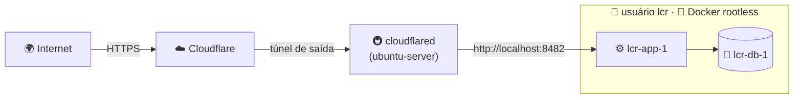

# ☁️ Deploy em produção

🌐 **URL:** https://lcr.d4ffy.com

## 🗺️ Como está montado



| Peça | Detalhe |
|---|---|
| 🖥️ Servidor | distro WSL2 `ubuntu-server` (Ubuntu 26.04) |
| 🚇 Exposição | **Cloudflare Tunnel**: `lcr.d4ffy.com` → `http://localhost:8482`. Nenhuma porta aberta na rede. |
| 👤 Isolamento | usuário de sistema dedicado `lcr`, com **Docker rootless** e *linger* (sobe sozinho no boot) |
| 🔒 Porta | publicada só em `127.0.0.1:8482` |
| 🍪 Cookie | `COOKIE_SECURE=true` (o túnel entrega HTTPS) |
| 📁 Código | `/home/lcr/app` |
| 🔑 Segredos | `/home/lcr/app/.env` (modo 600), gerado com senhas **aleatórias**, diferentes das do `.env.example` |

## 📦 Arquivos

* [`deploy/docker-compose.prod.yml`](../deploy/docker-compose.prod.yml): sobreposição do compose (cookie Secure + porta no loopback).
* [`deploy/install-ubuntu-server.sh`](../deploy/install-ubuntu-server.sh): instala ou atualiza tudo.

## 🚀 Instalar ou atualizar

Com o código copiado para o servidor (por exemplo com `git clone`):

```bash
sudo bash deploy/install-ubuntu-server.sh
```

O script é idempotente:

1. 📦 instala o `docker-buildx` (se o apt falhar, usa o builder clássico);
2. 👤 cria o usuário `lcr`, faixas de subuid/subgid e liga o *linger*;
3. 🐳 configura o Docker rootless do usuário;
4. 📁 copia o código para `/home/lcr/app`;
5. 🔑 gera o `.env` com segredos aleatórios **só se ainda não existir**;
6. 🏗️ faz o build e sobe com `docker compose -p lcr`;
7. ✅ espera `http://127.0.0.1:8482/api/ac` responder.

## 🛠️ Operação

```bash
sudo -iu lcr                      # entrar como o usuário do app
cd ~/app
docker compose -p lcr ps          # 📋 estado dos containers
docker compose -p lcr logs -f app # 📜 logs
docker compose -p lcr restart app # 🔁 reiniciar
```

## ⚠️ Cuidados

* 💾 **Faça backup do `/home/lcr/app/.env`.** Sem a `AC_SENHA`, as chaves da AC guardadas no banco ficam ilegíveis e nenhum certificado novo pode ser emitido.
* 🐘 O volume `lcr_pgdata` guarda usuários, certificados e PDFs. Backup: `docker compose -p lcr exec db pg_dump -U acme acme > backup.sql`.
* 🧠 A máquina tem pouca RAM livre: o build (Node + Go) pode levar alguns minutos.
